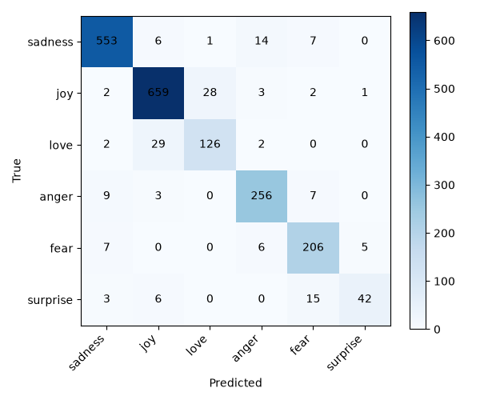

# Emotion classification

Fine-tuning and serving of a small transformer that tells which of six emotions (sadness, joy, love, anger, fear, surprise) a short English text expresses. It covers the whole path of an NLP project: data exploration, fine-tuning on Colab, evaluation, model publication on the Hugging Face Hub, a REST API and a Docker image.

- **Model**: [`pboissie/paraphrase-albert-small-v2-emotion`](https://huggingface.co/pboissie/paraphrase-albert-small-v2-emotion), [`sentence-transformers/paraphrase-albert-small-v2`](https://huggingface.co/sentence-transformers/paraphrase-albert-small-v2) fine-tuned for classification
- **Data**: [`dair-ai/emotion`](https://huggingface.co/datasets/dair-ai/emotion), 16,000 training, 2,000 validation and 2,000 test texts

## Results

On the 2,000-text test set: **accuracy 92.1%, macro F1 87.5%**. For reference, always predicting the most frequent emotion (joy, 695 of the 2,000 texts) would give about 35% accuracy.

| Emotion | Precision | Recall | F1 | Support |
|---|---|---|---|---|
| sadness | 0.960 | 0.952 | 0.956 | 581 |
| joy | 0.937 | 0.948 | 0.943 | 695 |
| love | 0.813 | 0.792 | 0.803 | 159 |
| anger | 0.911 | 0.931 | 0.921 | 275 |
| fear | 0.869 | 0.920 | 0.894 | 224 |
| surprise | 0.875 | 0.636 | 0.737 | 66 |

*Support* is the number of test texts of that emotion. *F1* balances precision and recall; *macro F1* averages it over the six emotions, so rare emotions weigh as much as frequent ones.



Surprise is the weakest emotion (recall 0.636, mostly mistaken for fear) and love is often mistaken for joy. Both are rare. The full numbers are in [`results/metrics.json`](results/metrics.json) and can be reproduced (see [Evaluation](#evaluation)).

## Quick start

### Without Docker

Python 3.10 or later:

```bash
git clone https://github.com/PierreBoissier/emotion_classification.git
cd emotion_classification
pip install -e .
uvicorn emotion_classification.api:app
```

The model is downloaded from the Hugging Face Hub when the API starts. Use `EMOTION_CHECKPOINT=<Hub id or local directory>` to serve another one. No GPU is needed for predictions.

### With Docker

```bash
docker build -t emotion-classification .
docker run -p 8000:8000 emotion-classification
```

The image downloads the model from the Hub when it is built. It is about 2.6 GB, as it also installs the training dependencies. Serve another model with `-e EMOTION_CHECKPOINT=<Hub id or mounted path>`.

### Using the API

```bash
curl -X POST http://127.0.0.1:8000/predict \
  -H "Content-Type: application/json" \
  -d '{"text": "i am so happy to see you again today"}'
# {"prediction":"joy"}

curl -X POST http://127.0.0.1:8000/predict_proba \
  -H "Content-Type: application/json" \
  -d '{"text": "i am terrified of what comes next"}'
# {"probabilities":{"sadness":0.0015,"joy":0.0020,"love":0.0003,"anger":0.0184,"fear":0.9761,"surprise":0.0017}}
```

Interactive documentation is served at http://127.0.0.1:8000/docs. Texts longer than 256 tokens are truncated.

## Training

Training runs on a GPU in Colab: open [the training notebook](https://colab.research.google.com/github/PierreBoissier/emotion_classification/blob/main/notebooks/train_emotion_classifier_with_colab.ipynb). It clones this repository, installs it, downloads the data, trains, evaluates on the test set and offers the trained model as a zip.

The same steps locally (slow without a GPU):

```bash
pip install -e .
python -m emotion_classification.loading_data   # downloads the data into data/
python -m emotion_classification.main           # trains, evaluates, saves into models/
```

Settings are in `src/emotion_classification/config.py`. The published model was trained for 10 epochs (learning rate 2e-5, weight decay 0.01, batches of 32 texts with gradients accumulated over 4 batches, mixed precision). See the [model card](docs/model_card.md) for details.

## Evaluation

Reproduce the results above with the published model:

```bash
pip install -e .
python -m emotion_classification.loading_data   # downloads the data into data/ (skip if already done)
python -m emotion_classification.evaluate pboissie/paraphrase-albert-small-v2-emotion --results-dir results
```

It writes `metrics.json` and `confusion_matrix.png` into `results/`. A local model directory works too.

## Tests

```bash
pip install -e ".[dev]"
pytest              # fast tests: the API and the evaluation, against a tiny model trained once per run
pytest -m slow      # end-to-end training and evaluation on a tiny model
```

Tests run offline: they train a tiny randomly initialised model on a few rows.

## Project structure

```
├── src/emotion_classification/
│   ├── config.py           # paths, hyperparameters, emotion labels, served model
│   ├── loading_data.py     # downloads dair-ai/emotion into data/
│   ├── dataset_builder.py  # tokenised dataset of one split
│   ├── data_loader.py      # dataloaders with dynamic padding
│   ├── trainer.py          # training loop and evaluation
│   ├── main.py             # train + evaluate entry point
│   ├── evaluate.py         # evaluate a model from the command line
│   ├── inference.py        # prediction from a trained model
│   ├── api.py              # FastAPI application
│   └── device.py           # CUDA / MPS / CPU selection
├── notebooks/
│   ├── data_exploration.ipynb                     # class balance, text lengths, frequent n-grams
│   └── train_emotion_classifier_with_colab.ipynb  # training on Colab
├── results/                # metrics and confusion matrix of the published model
├── docs/model_card.md      # model card published on the Hugging Face Hub
├── data/                   # downloaded data (not tracked by git)
├── tests/
├── GLOSSARY.md             # vocabulary used in the project
├── Dockerfile
├── pyproject.toml
└── environment.yml         # conda environment (not tested)
```

## Limitations and future work

- English only. The dataset is made of tweets labelled from hashtags, so labels are noisy and the model reflects that style of writing.
- One emotion per text: mixed or neutral feelings are not modelled.
- Rare emotions (surprise, love) are the weakest.
- Only one base model was trained. [`all-mpnet-base-v2`](https://huggingface.co/sentence-transformers/all-mpnet-base-v2) and [`all-MiniLM-L6-v2`](https://huggingface.co/sentence-transformers/all-MiniLM-L6-v2) are natural candidates to compare against it.
- Dependencies are not pinned and the Docker image is large; the API does not need the training dependencies.

## License

[MIT](LICENSE), Pierre Boissier.
